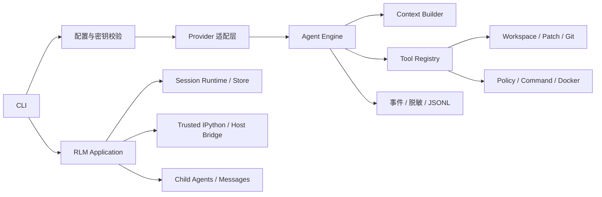

# ForgeAgent

> A transparent, security-conscious coding agent for local repositories.

[](https://github.com/jensen-Zeng/ForgeAgent/actions/workflows/ci.yml)
[](https://www.python.org/)
[](./CHANGELOG.md)
[](./LICENSE)

ForgeAgent 是一个运行在终端中的本地代码仓库 Agent。它把模型调用、上下文管理、工具执行、审批、安全策略、会话恢复和评测拆成清晰的模块，使每次修改都可审查、可追踪、可测试。

项目同时提供两种明确分离的运行模式：

- `forge run`：默认安全模式，通过受控工具读写仓库，并按本地策略审批命令和补丁。
- `forge rlm ... --trust-workspace`：显式可信模式，提供持久 IPython Kernel、会话恢复、子 Agent 和消息机制；Kernel 继承当前用户权限，因此不是沙箱。

## 核心能力

- OpenAI-compatible、Anthropic、Ollama 和可脚本化 Fake Provider。
- 模型—工具闭环、流式事件、明确停止原因以及 Token、费用、时间和工具调用预算。
- 工作区边界、敏感路径拒绝、精确上下文补丁、原子写入和 Git Diff。
- `SAFE / REVIEW / DENY` 命令策略，以及本地执行和 Docker 沙箱的自动路由。
- JSONL 轨迹、统一事件、密钥脱敏、输出截断和可回放运行结果。
- 持久会话、输入队列、follow-up/steer、恢复标记和结构化上下文压缩。
- 持久 IPython Kernel、Host Bridge、递归子 Agent、家族消息和共享预算账本。
- 20 项确定性评测目录、Provider 协议回归和跨平台 CI。

## 项目状态

当前版本为 `0.3.0.dev0`，属于 Alpha 阶段。

- 默认安全模式和可信 RLM 第一阶段已经完成离线实现。
- 本地完整回归为 `224 passed`，覆盖率 `86.16%`，门禁为 80%。
- GitHub Actions 覆盖 Windows/Linux 与 Python 3.12/3.13。
- RLM 测试使用真实本地 IPython Kernel，但模型为 Faux/Mock；这证明会话和桥接行为，不代表在线模型效果。
- Docker 规格和自动路由已有测试，但真实隔离能力仍需在实际 Docker 宿主上验收。
- 真实 Provider 的质量、兼容性和费用结论必须通过用户自己的服务配置和预算验证。

尚未完成的工作只维护在 [路线图](./docs/ROADMAP_PRIORITIES.md) 中。

## 快速开始

### 1. 安装

需要 Python 3.12+ 与 Git。

```powershell
git clone https://github.com/jensen-Zeng/ForgeAgent.git
Set-Location ForgeAgent
python -m venv .venv
.\.venv\Scripts\python.exe -m pip install --upgrade pip
.\.venv\Scripts\python.exe -m pip install -c requirements\constraints.txt -e ".[dev,rlm]"
```

Linux/macOS 可将激活后的 Python 与命令替换为 `python`、`pip` 和 `forge`。

### 2. 离线检查

不配置模型也可以检查环境、工具和测试：

```powershell
.\.venv\Scripts\forge.exe --help
.\.venv\Scripts\forge.exe config check --allow-missing-model
.\.venv\Scripts\forge.exe doctor
.\.venv\Scripts\forge.exe tools list --workspace .\examples\read_only_repo
.\.venv\Scripts\python.exe -m pytest -q
```

### 3. 配置模型

密钥只应放在当前终端或私有配置中，不要提交到仓库：

```powershell
$env:FORGE_MODEL_PROVIDER = "openai"       # openai / anthropic / ollama
$env:FORGE_MODEL_BASE_URL = "https://example.com/v1"
$env:FORGE_MODEL_NAME = "provider-model-id"
$env:FORGE_MODEL_API_KEY = "your-api-key"
$env:FORGE_AGENT_MAX_COST_USD = "1.00"
```

Ollama 不要求 API Key。完整参数、价格快照和费用边界见 [模型配置](./MODEL_CONFIGURATION.md)。

### 4. 运行安全模式

```powershell
.\.venv\Scripts\forge.exe run `
  "解释这个示例项目的入口、数据流和测试结构" `
  --workspace .\examples\read_only_repo
```

每次运行都会显示工作区、Provider、模型和预算，但不会显示密钥。轨迹默认写入目标工作区的 `.forge/traces/<run-id>.jsonl`。

开始前请提交或备份目标仓库，并审查 Agent 最终给出的 Diff。模型无法绕过本地路径、审批和命令策略。

## 可信 RLM 模式

RLM 模式适合需要持久 Python 状态、长会话、子 Agent 或结构化压缩的任务：

```powershell
.\.venv\Scripts\forge.exe rlm run `
  "分析仓库并使用 Python 辅助完成任务" `
  --workspace . `
  --trust-workspace

.\.venv\Scripts\forge.exe rlm resume <SESSION_ID> --workspace . --trust-workspace
.\.venv\Scripts\forge.exe session list --workspace .
.\.venv\Scripts\forge.exe session show <SESSION_ID> --workspace .
.\.venv\Scripts\forge.exe session repair <SESSION_ID> --workspace . --truncate-tail
```

`--trust-workspace` 是权限确认，不是安全装饰。Kernel 可以直接导入 `os`、`subprocess` 和文件 API，并拥有启动 ForgeAgent 的用户权限。仅对已经信任的仓库启用此模式。

ForgeAgent 会从 Kernel 环境中移除常见凭据变量，不注入 API Key、Provider、SessionStore 或子 Agent 管理对象。通过 `execute_python`、`rlm.shell()`、`rlm.spawn()` 和 `agent_message.send()` 发出的操作可以被宿主校验和记录，但这些机制不能阻止 Kernel 中的任意 Python 代码。

会话保存在 `.forge/sessions/<root-session-id>/`。日志采用追加式 JSONL；恢复时不会自动重放状态不确定的副作用。

## 安全执行模型

ForgeAgent 不接受模型自行声明风险级别、审批状态或执行后端。宿主策略根据结构化命令请求做出决定：

| 级别 | 示例 | 默认行为 |
| --- | --- | --- |
| `SAFE` | `git status`、pytest、mypy、`ruff check` | 清理敏感环境变量后本地执行 |
| `REVIEW` | 格式化器、包管理器、可能修改环境的命令 | 展示完整命令并要求批准；批准后进入 Docker |
| `DENY` | Shell、提权、网络客户端、破坏性 Git、任意删除 | 在选择后端前拒绝 |

默认执行后端为 `auto`。Docker 不可用时，必须进入沙箱的命令返回 `sandbox_unavailable`，不会降级到本地执行。

安全边界和漏洞报告方式见 [SECURITY.md](./SECURITY.md)，Docker 威胁模型与配置见 [Docker 指南](./docs/DOCKER_SETUP.md)。

## 架构



关键设计原则：

1. Runtime、工具和上下文层只依赖 ForgeAgent 的领域模型，不依赖厂商 SDK 对象。
2. 模型输出是未受信任输入；权限由本地代码决定。
3. 所有终态都有机器可读停止原因，异常和取消必须释放资源。
4. 持久状态只追加写入；不确定副作用不自动重放。
5. 模拟测试和 reference 评测不能被描述为真实模型或真实容器证据。

详细组件和数据流见 [架构文档](./docs/ARCHITECTURE.md) 与 [ADR](./docs/adr/)。

## Provider 与配置

Provider 层把不同服务规范化为统一的消息、工具调用、Usage 和流事件：

| Provider | 入口 | 说明 |
| --- | --- | --- |
| OpenAI-compatible | `FORGE_MODEL_PROVIDER=openai` | Chat Completions 兼容接口，支持 SSE 文本与工具参数聚合 |
| Anthropic | `FORGE_MODEL_PROVIDER=anthropic` | Messages API；当前以完整响应适配统一事件 |
| Ollama | `FORGE_MODEL_PROVIDER=ollama` | 本地兼容服务，不要求 API Key |
| Fake | 测试注入 | 可脚本化文本、工具分片、延迟、错误和 Usage |

配置优先级为：内置默认值 < `forge.toml` < 环境变量 < CLI 覆盖。ForgeAgent 不自动读取目标仓库中的 `.env`。

## 评测与质量门禁

```powershell
.\.venv\Scripts\forge.exe eval list
.\.venv\Scripts\forge.exe eval run --mode reference --repetitions 3

.\.venv\Scripts\ruff.exe format --check .
.\.venv\Scripts\ruff.exe check src tests
.\.venv\Scripts\mypy.exe
.\.venv\Scripts\python.exe -m pytest --cov=forge_agent --cov-report=term-missing --cov-fail-under=80 -q
.\.venv\Scripts\python.exe -m pip check
git diff --check
```

`reference` 模式验证评测器和确定性参考实现，不是模型成绩。真实报告必须记录 Provider、模型 ID、Prompt 版本、任务快照、重复次数、Token、费用和失败类型。

## 项目结构

```text
ForgeAgent/
├── src/forge_agent/
│   ├── models/          # Provider 协议与适配器
│   ├── tools/           # 仓库、补丁、Git、命令和 Kernel 工具
│   ├── tracing/         # 事件、脱敏与 JSONL Sink
│   ├── session/         # 持久 Store、队列和恢复
│   ├── kernel/          # IPython 与 Host Bridge
│   ├── engine.py        # 单轮 Engine 与取消域
│   ├── runtime.py       # 默认 Agent Loop
│   ├── rlm.py           # 可信 RLM 装配
│   ├── children.py      # 子 Agent 生命周期
│   └── compaction.py    # 结构化压缩
├── tests/               # 单元、集成与 RLM 离线测试
├── examples/            # 可公开运行的示例仓库
├── docs/                # 架构、操作指南、路线图与 ADR
├── reports/             # 可复现的 reference/合成报告
├── docker/              # 最小权限镜像与离线依赖示例
└── .github/workflows/   # 跨平台 CI 与受控发布工作流
```

## 文档

- [架构说明](./docs/ARCHITECTURE.md)
- [新手指南](./BEGINNER_GUIDE.md)
- [模型配置](./MODEL_CONFIGURATION.md)
- [安全策略](./SECURITY.md)
- [Docker 配置](./docs/DOCKER_SETUP.md)
- [已知失败与边界](./docs/FAILURE_CASES.md)
- [演示流程](./docs/DEMO.md)
- [实施与发布计划](./IMPLEMENTATION_PLAN.md)
- [未完成路线图](./docs/ROADMAP_PRIORITIES.md)
- [变更记录](./CHANGELOG.md)

## 参与贡献

请先阅读 [CONTRIBUTING.md](./CONTRIBUTING.md)。提交应保持范围明确，并包含相邻测试、兼容性说明和安全影响。安全漏洞请使用 [GitHub Private Vulnerability Reporting](https://github.com/jensen-Zeng/ForgeAgent/security/advisories/new)，不要在公开 Issue 中披露凭据或利用细节。

## 许可证

ForgeAgent 使用 [MIT License](./LICENSE)。第三方依赖许可证说明见 [THIRD_PARTY_LICENSES.md](./THIRD_PARTY_LICENSES.md)。
