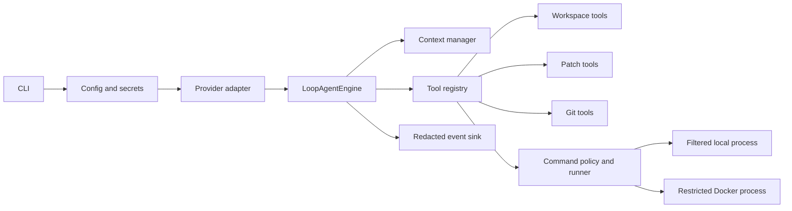
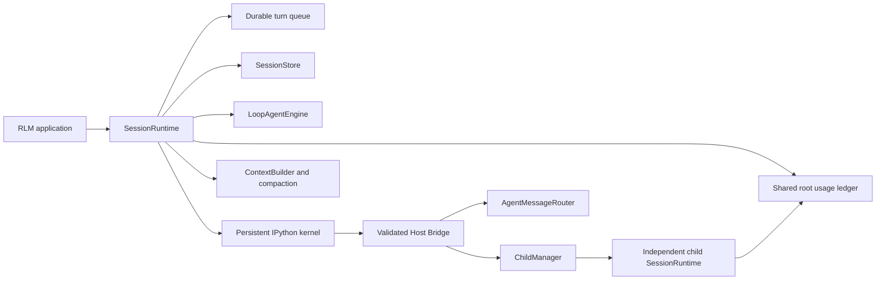

# Architecture

ForgeAgent is organized around explicit contracts and two execution planes: a bounded safe coding agent and an opt-in trusted RLM runtime. Both share provider-neutral models, usage accounting, events, and repository abstractions.

## Design goals

- make model decisions observable without granting them authority;
- keep repository side effects bounded, reviewable, and recoverable;
- support multiple model providers behind one domain protocol;
- preserve enough durable state to inspect and resume long tasks;
- distinguish simulated evidence from real provider or sandbox validation.

## Safe coding plane

`LoopAgentEngine` is the authoritative model/tool loop. It checks cancellation and budgets, requests a normalized provider response, validates tool arguments, executes a registered tool, and adds the observation to context. A turn ends with one explicit stop reason.

The runtime never accepts a model-provided risk class, approval result, or backend. Those are calculated by local policy after tool arguments are parsed.

### Concurrent repository editing

Safe and trusted `run` entry points select a managed Git worktree by default. The source must be the Git top-level directory, have a commit, have no tracked or staged changes (including under `.forge/`), and have no untracked files outside `.forge/`; only untracked `.forge/` metadata is exempt. ForgeAgent does not stash or discard source edits. Each run uses a retained branch `forge/<uuid>` and checkout under `.forge/worktrees/<uuid>/checkout`; session data is rooted in that checkout. Workspace inspection exposes a bounded diff against the recorded base commit, including safe, bounded untracked text files. Secrets, symlinks, binary/oversized files, and excessive output are excluded.

This separates working copies, not processes or permissions. Changes saved in the source checkout while a run is active do not enter the Agent checkout. The Agent does not commit, merge, delete, or push automatically. Users review the diff and merge the branch themselves. The worktree is not a sandbox, especially in RLM mode.

`--in-place` opts into a shared checkout. CLI `run`/`resume` operations acquire an exclusive workspace lock, and an active RLM session additionally owns its session lock. A second CLI operation fails with `workspace_busy`. The production patch registry requires a host-recorded read before modifying a file. After approval, patch application obtains canonical per-file advisory locks in sorted order and verifies the observed digest and exact old text before replacing. Optional `base_sha256` pins the caller's expected version. A changed version fails with `stale_read` or `concurrent_modification`; missing a required read fails with `read_required`; lock contention can fail with `write_lock_timeout`. Recovery requires another read and a new approved patch, never an automatic merge.

New files use atomic create-if-absent. Individual replacements are atomic, but a multi-file patch is not transactional; rollback is best-effort and checks for external modifications before restoring. Advisory locks do not bind editors or unrelated processes, and unsaved buffers are invisible. A narrow time-of-check/time-of-use race remains with applications that ignore the lock.

## Trusted RLM plane

Each session has one ordinary turn writer and one serial kernel. Inputs are appended and synchronized before acceptance is returned. Child agents receive separate contexts, kernels, cancellation scopes, and artifact directories while sharing the root usage budget and trusted family. This is runtime-state separation, not a security boundary: child kernels can execute arbitrary Python with the same user permissions and may use absolute paths.

RLM mode starts only after explicit `--trust-workspace` consent. The kernel inherits user permissions and is not a sandbox.

## Core contracts

### Domain models

Messages, content blocks, tool calls, usage, results, budgets, and stop reasons live in `forge_agent.domain`. Provider implementations translate their wire formats at the boundary.

### Provider stream

Providers emit a common stream of text deltas, tool-call deltas, usage, completion, and error events. The compatible `generate()` API collects these events into a complete response.

### Tools

Every tool has a name, description, validated arguments, and structured result. Tool failures are data, not unfiltered exceptions. Filesystem tools resolve paths through `Workspace`; command tools use separate executable and argument fields.

### Runtime events

Events carry stable event/session/run identifiers, generation, correlation, kind, and data. Parent relationships and paired terminal events make model, tool, kernel, child, and message activity reconstructable.

### Session log

Session storage is append-only UTF-8 JSONL. Records include stable IDs, parent IDs, timestamps, and types. Replay restores messages, usage, queue state, compactions, and child state. A partial tail is reported, not silently repaired.

## Trust boundaries

| Boundary | Trusted component | Untrusted input | Enforcement |
| --- | --- | --- | --- |
| Model | host runtime | text and tool arguments | schema validation, budgets, local policy |
| Filesystem | `Workspace` | model paths | canonical containment and sensitive-path checks |
| Commands | policy/runner | executable and args | deny rules, approvals, backend routing, timeout |
| Docker | host daemon/config | target repository code | no network, non-root, read-only root, resource limits |
| RLM bridge | host-bound kernel identity | comm payload | strict schemas, method allowlist, timeouts |
| Persistence | single session writer | runtime records | append-only schemas, fsync, explicit repair |
| Shared checkout writes | ForgeAgent lock and patch host | editor/other process | exclusive run lock, sorted per-file advisory lock, observed digest check; non-cooperating writers remain outside the guarantee |
| Isolated checkout | Git worktree manager | source repo state | committed source with no tracked/staged changes and only untracked `.forge/` metadata allowed, UUID manifest validation, safe bounded diff; worktree is not a sandbox |

Docker reduces command risk but is not a virtual machine. The trusted IPython kernel is deliberately outside the sandbox model.

## Cancellation and cleanup

Cancellation is cooperative at model stream and tool boundaries, then escalates for subprocesses and kernels. Process-tree cleanup checks platform return codes and falls back to recursive terminate/kill. Busy flags and resources are restored in `finally` blocks so one failed turn cannot permanently lock a session.

Interrupted operations with possible side effects are recorded as uncertain and are not replayed automatically.

## Context and compaction

The context builder walks the active session branch, keeps recent entries verbatim, bounds tool output, and never splits a tool call from its result. When the configured window threshold is reached, it requests a structured summary with fixed sections and persists the summary plus the first retained entry ID. Summary failure leaves history intact; an unrecoverable overflow stops explicitly.

Kernel memory is independent from model context compaction and may be lost after a kernel crash or process restart.

## Extension points

- implement the provider protocol for another model service;
- register a typed tool with deterministic authorization rules;
- add a session entry type with backward-compatible replay behavior;
- add an evaluator while preserving the distinction between reference and live-model evidence.

New capabilities that create external side effects require policy, approval, audit, cancellation, recovery, and tests before they are enabled by default.
